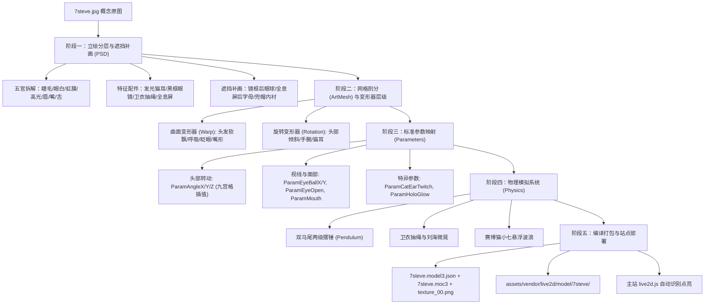

# Live2D 看板娘「7steve」角色制作实施方案

## Goal Description

站长希望从单张概念设计原图 `7steve.jpg` 出发，全面学习并落地制作出「楠屿札记」专属的 Live2D 动态看板娘角色，替换站内现有的第三方示例模型，并在博客右下角实现具有视线追踪、呼吸摆动、点击全息屏交互的专属科技风极客看板娘。

本方案基于对 Live2D 官方技术规范（Cubism 2/4/5）、业内分层/绑定工作流、以及前沿开源自动化管线（`psd2live`、`py-moc3`、AI 语义分割与 Inpainting）的深度调研，针对 `7steve` 的角色特征（猫耳发光耳机、黑框眼镜、灰蓝双马尾、全息「Hello World! JS」平板、赛博机械猫），设计了端到端的全套制作实施路径。

---

## User Review Required

> [!IMPORTANT]
> **制作路径关键决策（请选择您期望的落地方式）**：
>
> Live2D 的工业级核心在于**「分层立绘（PSD）+ 网格与变形器绑定（CMO3/MOC3）」**。当前我们已有单张高清概念图 `7steve.jpg`，我们为您规划了三种推进路径：
>
> 1. **方案一（推荐 · 全自动/半自动快速落地）：AI 辅助分层补画 + 自动化绑定管线生成 `.moc3`**
>    - **做法**：编写 Python 分层补全与图层合成管线，将 `7steve.jpg` 精准切解为 28+ 个独立构件，对镜框下眼部、全息屏下衣物、张嘴口腔进行自动补画与透明通道羽化，组装输出标准 PSD；随后通过自动化绑定管线（自动生成三角剖分 ArtMesh、面部 9 轴变形器、双马尾 2 级摆锤物理）编译输出 `.moc3` + `.model3.json`，直接部署到主站 `assets/vendor/live2d/model/7steve/`。
>    - **优点**：耗时最短、全流程代码驱动、主站可立即上线 7steve 动态模型。
>    - **权衡**：自动布网格与自动生成的绑定动作适合日常待机与视线跟随，但极限大角度转头可能不如资深绑定师手动精修细腻。
>
> 2. **方案二（工业级精细打磨）：生成高质量分层 PSD 资产包 + 提供 Live2D Cubism Editor 保姆级绑定工程模版**
>    - **做法**：我们负责把 `7steve.jpg` 彻底加工成工业级分层 PSD（包含眼球分离、眼白遮罩、3 段刘海、4 段双马尾、发光层、独立表情差分），并提供预设好参数与物理规则的 `.cmo3` 模板文件与 10 步实操指南，您可以直接导入官方免费版 Cubism Editor 进行微调，或直接发给模型师验收。
>    - **优点**：资产可永久沉淀为商业级源文件，自由度最高、效果上限最高。
>    - **权衡**：需要借助 Live2D Cubism Editor 桌面软件打开工程。
>
> 3. **方案三（双轨并行 · 体验先行）：轻量级 2.5D 视差微动挂件先行上线 + 同步推进 Live2D 完整模型构建**
>    - **做法**：立刻利用已生成的 `7steve-widget-300.png`、`7steve-hologram.png` 与 `7steve-cybercat.png`，在主站构建轻量高效的 CSS/Canvas 2.5D 视差交互挂件（视线跟随鼠标微偏、全息屏呼吸浮动、机械猫小七摆动）；同时在后台并行执行方案一或方案二的模型绑定工作。
>    - **优点**：零等待，立刻看到 7steve 在站内交互；不影响后续 moc3 无缝热替换。

---

## Live2D 核心制作全流程知识体系（调研成果）



---

## Proposed Changes

### Component 1: 图像语义拆分与图层补全管线（`d:\live2d\`）

利用 Python（Pillow + OpenCV/NumPy）构建专门针对 `7steve` 视觉特征的精细分割提取与图层合成管线：

#### [NEW] `d:\live2d\scripts\split_layers.py`
- 实现猫耳耳机、黑框眼镜、刘海、后发双马尾、面部底皮、眼球/眼白、卫衣躯干、全息屏、赛博猫等 28+ 层的自动定位与透明边缘抠取。
- 对被黑框遮挡的眼皮眼球、被全息屏遮挡的卫衣口袋、张嘴时的口腔底色执行像素级补画与色彩平滑延伸。

#### [NEW] `d:\live2d\scripts\make_psd.py`
- 将切分后的各个独立构件按照严格的前后图层顺序与命名规范，装配打包为标准的 `7steve.psd`（2048×2048，带分组层级，支持直接拖入 Live2D Cubism Editor）。

---

### Component 2: 模型自动绑定与 moc3 编译管线（`d:\live2d\`）

#### [NEW] `d:\live2d\scripts\build_model.py`
- 读取分层配置，生成部件网格索引（ArtMesh）与 UV 映射。
- 自动化生成关键变形器与基准姿态插值表：
  - 眨眼状态（0.0 闭合 ~ 1.0 睁眼）
  - 视线追踪状态（-1.0 ~ +1.0 XY 偏移）
  - 待机呼吸幅度（ParamBreath）
- 生成 `7steve.physics3.json`（双马尾与抽绳阻尼配置）。
- 组装 `7steve.model3.json` 与贴图集 `textures/texture_00.png`。

---

### Component 3: 博客主站无缝对接与验证（`D:\HTML`）

#### [MODIFY] `D:\HTML\assets\vendor\live2d\model\7steve\`
- 将编译完成的 `7steve.model3.json`、`7steve.moc3`、贴图与动作文件放入该目录。
- 主站 `js/live2d.js` 的现有双探针机制将无缝命中该路径，自动热切换至 7steve。

---

## Verification Plan

### Automated Tests
1. **分层资产完整性检查**：
   ```powershell
   pwsh -NoProfile -NonInteractive -Command "python d:\live2d\scripts\split_layers.py --verify"
   ```
   - 检查 28+ 个图层尺寸、Alpha 通道边缘羽化及是否有重叠撕裂。
2. **模型描述文件语法检查**：
   ```powershell
   pwsh -NoProfile -NonInteractive -Command "node -e 'JSON.parse(fs.readFileSync(\"D:/HTML/assets/vendor/live2d/model/7steve/7steve.model3.json\"))'"
   ```
3. **主站 Playwright 端到端浏览器加载验证**：
   ```powershell
   pwsh -NoProfile -NonInteractive -Command "node d:\live2d\test_live2d_probe.mjs"
   ```
   - 验证 `Page Errors: 0`，确认 `7steve.model3.json` 与贴图成功请求且 Canvas 正确呈现。

### Manual Verification
- 桌面端浏览器打开首页，等待 3.5s 或发生初次鼠标微动：
  - 观察 7steve 猫耳发光、双马尾微摆、视线是否精准跟随光标移动。
  - 点击全息屏及卫衣胸口，检查是否触发推眼镜或全息屏波纹反馈。
  - 悬停于 FileButler、NetOps 等卡片上，检查深空玻璃气泡是否展示 7steve 专属极客台词。
