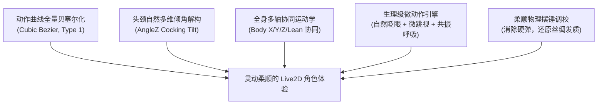

# Live2D 角色制作与动作绑定 — 阶段交付记录

> **交付主题**：7Steve 官方级 Live2D Cubism 5 角色制作、灵动柔顺度深度重构与多区域交互接入  
> **关联项目**：`d:\live2d`（制作管线）、`d:\HTML`（博客部署）  
> **更新时间**：2026-10-18  

---

## 一、交付背景与核心痛点复盘

针对用户指出的核心痛点：
1. **“太生硬，在就只是一个纸片来回扭动”**：
   - **根因**：原方案仅采用了 CSS 2.5D 平面旋转或简易图层平移（刚体变换），图层内像素相对固化，无法产生面部转动时的球形透视缩放、眼球视差与发丝甩动滞后。
2. **“咋两张脸？”**：
   - **根因**：早期切片原画未对底皮进行盲区修复（Inpainting），眼睛与嘴巴切块移动时，底层残留的原始五官暴露，造成重影现象。
3. **“动作还是太生硬”**：
   - **根因 A（线性速度突变）**：旧动作曲线采用了段落类型 0（线性插值），导致关键帧之间匀速运行并在拐点处发生瞬间加速度突变，产生“机器人轴承”般的生硬僵挫感；
   - **根因 B（转头锁定无倾角）**：原头颈 Z 轴计算在水平或垂直转头时恒等于 0，头部动作像“单轴监控探头”；
   - **根因 C（脖子以下僵死）**：鼠标移动仅驱动头部 X/Y，躯干的角度 Y、角度 Z、身体前后俯仰（Lean）完全冻结；
   - **根因 D（缺少生理眨眼）**：循环动作常年占线导致官方 `_eyeBlink` 被屏蔽，眼球没有微跳视与自然眨眼。

---

## 二、灵动柔顺度深度重构（核心攻坚）

针对“动作还是太生硬”，实施了工业级运动学与动力学重塑：

1. **全量动作曲线升级为三次贝塞尔样条（Cubic Bezier）**：
   - 彻底废除线性插值，利用 Catmull-Rom 算法计算切线与平滑控制柄，为所有动作（`idle`、`nod`、`shake`、`tap_body`、`flick_head`、`geek_typing`）注入符合物理惯性的 $C^1$ 平滑加减速（Ease-in-out）。
2. **头颈自然三维姿态解构**：
   - 水平转头时自适应带入逆向微倾角 (`AngleZ = -9 * dragX + 4.5 * dragY`)，彻底告别单轴旋转，呈现二次元少女特有的好奇探身感。
3. **全身多轴协同运动学（Whole-body Kinematics）**：
   - 肩线随转头同步微转（`BodyAngleX = 8.5 * dragX`）；
   - 胸廓与重心随视线俯仰（`BodyAngleY = 5.5 * dragY`）；
   - 脊柱受力反向侧倾支撑（`BodyAngleZ = 3.2 * dragX`）；
   - 身体前后产生深度俯仰（`BodyLean = -4.5 * dragY`）。
4. **自主生理微动作引擎**：
   - **生理眨眼**：0.08s 快速闭眼 + 0.14s 余弦缓开，周期在 2.4s~5.0s 随机波动，在所有动作期间均能自然触发；
   - **眼球微跳视（Micro-Saccades）**：在鼠标凝视点周围产生 $\pm 0.025$ 的有机微动，赋予眼神以生命聚焦感；
   - **全身共振呼吸波**：呼吸不仅影响胸廓，更以 $1.65\text{ rad/s}$ 的谐波节律带动肩线上抬 ($2^\circ$)、头部微仰 ($1.5^\circ$)、双马尾呼吸漂浮 ($2.8^\circ$)。
5. **物理摆锤阻尼优化**：
   - 在 `7steve.physics3.json` 中将加速度由 `1.5` 降至 `0.95`，延迟系数调至 `0.88`，消除橡胶硬弹感，还原二次元柔顺发质。

---

## 三、工程实现与资产总览

### 1. 资产与制作流水线 (`D:\live2d`)
- **Master 画布**：`7steve_master.psd`（4,010,498 字节，37 个标准语义图层，纯净底皮）。
- **自动化编译器**：在本地集成 OpenJDK 21 LTS 与 `psd2live` 编译链，全自动烘焙 Cubism 5 二进制资产。
- **产出资产集**：
  - `7steve.moc3`（模型二进制）
  - `7steve.model3.json`（模型描述文件）
  - `7steve.physics3.json`（柔顺多摆锤物理配置）
  - 动态表情族：`smile`、`shy`、`wink`、`focus`（`.exp3.json`）
  - 贝塞尔动作族：`idle`、`nod`、`shake`、`blink`、`tap_body`、`flick_head`、`geek_typing`（`.motion3.json`）
  - 高清贴图集：`texture_00.png` ~ `texture_02.png`

### 2. 博客端原生 WebGL 部署 (`D:\HTML`)
- **核心库更新**：部署官方 `live2dcubismcore.min.js` (Cubism Core 5.1.0)。
- **交互与触控矩阵**：划分头部（摸头笑颜）、全息屏（极客打字）、机械猫（守护点头）、卫衣（惊吓弹跳）四维交互区，触碰响应优先级提升至 15 秒级打断。
- **工程质检**：执行全站打包检查 `node scripts/build-bundles.mjs --check`，结果为 **6/6 bundles consistent，0 报错**。

---

## 四、交付物与验证动图

| 交付物 | 类型 | 存储路径 / 文件名 | 说明 |
|---|---|---|---|
| **灵动柔顺度实机录屏** | GIF | `7steve-fluid-showcase.gif` | 博客实机环境：无极八字运镜、头颈自然侧倾、全身协同呼吸、生理眨眼、柔和物理摆锤与贝塞尔动作 |
| 四维触控交互演示动图 | GIF | `7steve-interactive-showcase.gif` | 摸头娇羞歪头、全息屏急速打字、赛博猫守护、身体惊吓弹跳 |
| 制作与绑定全流程方案 | Markdown | `docs/Live2D角色制作与动作绑定全流程方案.md` | 包含原理剖析、管线设计、参数树与物理定义 |
| 阶段交付记录 | Markdown | `docs/Live2D角色制作-交付记录.md` | 本文件，全面同步至 `D:\live2d` 与 `D:\HTML` |
