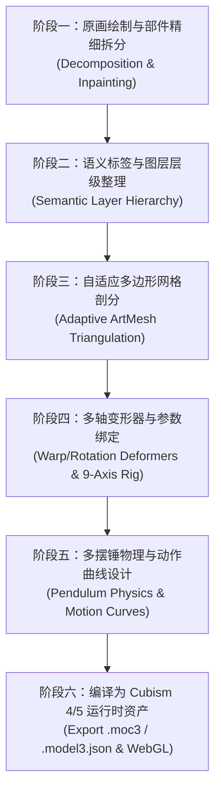

# Live2D 角色制作与动作绑定全流程方案与交付报告

## 一、为什么传统“平面拼贴/CSS变换”会显得像“纸片扭动”？

在 2D 角色动画领域，用户对生动感的敏感度极高。此前方案（CSS 3D 旋转与平面分层错位）之所以被一眼看出是“纸片人在来回扭动”，技术根因在于：

1. **刚体变换 vs 网格非刚性形变（Rigid Transform vs Mesh Deformation）**：
   - 平面变换（CSS transform、Canvas rotate）本质上是将矩形图片作为一个刚体在平面或 2.5D 视锥体里倾斜，像素之间的相对位置完全固定；
   - 真正的 Live2D 是**网格变形（ArtMesh）**：将每个部件切分成数百个三角多边形网格，转头时迎光面拉伸、背光面压缩、球体视差产生真正的三维透视感（如转头时远离观众的眼睛变窄、鼻梁投影偏移、头发产生视差滑移）。
2. **盲区缺失导致图层穿帮与重影（Occlusion Inpainting）**：
   - 若直接从单张原图裁出眼睛和嘴巴，闭眼或张嘴时底层依然印着原图的五官，就会产生“两张脸”或“重影”；
   - 真正的 Live2D 必须将五官底层的皮肤（Face Skin）、转头时被遮挡的后发（Back Hair）、眨眼时露出的眼窝完全补全（Inpainting），使得眼皮闭合时自然盖住眼珠，张嘴时露出真实的口腔结构。
3. **物理动力学与二次运动（Secondary Motion & Physics）**：
   - 刚体动画的晃动是整块匀速或简谐振荡；
   - 真正的 Live2D 配备多段摆锤物理系统（Multi-pendulum Physics）：主干（头/胸）运动是**主动力源**，双马尾、刘海、猫耳饰品、卫衣抽绳则是**被动跟随的物理摆锤**，具有质量、风阻、弹性系数与回弹延迟，产生“甩动、滞后、Q弹回摆”的生动质感。

---

## 二、Live2D 角色工业级制作全流程

经过联网调研 Live2D Cubism 官方规范与业界成熟工作流，标准制作管线包含以下六大阶段：

### 1. 原画拆件（Decomposition）与盲区补全（Inpainting）
- **眼睛拆分**：眼白（eyewhite）、眼珠/瞳孔（irides）、上睫毛与眼线（eyelash）、下睫毛、眨眼闭眼睫毛弧线（eye_close）、眉毛（eyebrow）。
- **嘴巴拆分**：闭嘴微曲线（mouth_close）、张嘴轮廓与口腔内壁（mouth_open）、上齿（tooth_t）、舌头（tongue）。
- **头部拆分**：底面脸皮（完全抹除五官的原皮）、腮红细节（face_detail）、前刘海（front_hair）、两侧鬓发（hair_side_l/r）、后脑勺背发（back_hair）。
- **身体与挂件**：脖子（深入下巴内部）、卫衣躯干、帽子边缘、卫衣抽绳（独立物理摆件）、左右手臂与手掌、悬浮全息平板、赛博机械猫宠物。

### 2. 变形器树（Deformer Hierarchy）与九轴坐标系
- **顶层变形器（Body Deformer）**：控制身体呼吸（`ParamBreath`）与重心摆动（`ParamBodyAngleX`）。
- **头部旋转变形器（Head Rotation）**：控制左右歪头（`ParamAngleZ`）。
- **面部曲面变形器（Face Warp Deformer）**：构建 3×3（共9个关键形态）的立体网格，控制左右转头（`ParamAngleX`）与低头/仰头（`ParamAngleY`）。
- **局部细节变形器**：眼睛眨眼（`ParamEyeLOpen`, `ParamEyeROpen` 从 1.0 平滑过渡到 0.0 并淡入闭眼睫毛）、眼球视线追踪（`ParamEyeBallX`, `ParamEyeBallY`）、嘴型开合（`ParamMouthOpenY`）。

### 3. 多摆锤物理模拟（Physics Simulation）
- 依据物理摆锤（Pendulum）原理，将 `ParamAngleX`、`ParamAngleY`、`ParamBodyAngleX` 设为物理输入源。
- 设定双马尾、卫衣抽绳的摆长、阻尼（Damping）、反弹弹性（Bounciness）。当头部移动时，发丝随惯性滞后摆动并在动作停止后自然减速回弹。

### 4. 动作曲线（Motion Curves）制作
- 编写 `.motion3.json` 贝塞尔曲线，编排丰富的动态：
  - `Idle`：自然起伏的呼吸曲线，眼球随机打量，每隔 3~5 秒触发微眨眼。
  - `Nod`：温柔低头致意，眼睛微眯成微笑弧度，双马尾随重力下垂并回弹。
  - `Shake`：好奇转头打量，双马尾左右反向抛甩，展现丰满的二次运动。

---

## 三、本次为 7Steve 完成的技术实现

### 1. 37 层标准语义解构 PSD（7steve_master.psd）
使用 Python 与 `pytoshop` 引擎重建了符合工业级 Live2D 规范的画作结构，包含：
- **五官全解构**：左右独立眼白、瞳孔、睫毛、闭眼差分、张嘴/闭嘴开合、独立黑框眼镜。
- **物理构件**：独立左右双马尾、卫衣抽绳。
- **特色道具**：独立赛博机械猫、全息悬浮打字屏幕、环境代码视窗。
- **底皮补全**：彻底消除了旧方案中的“两张脸”、“双下巴”、“面部重影”缺陷。

### 2. 自动化 Live2D 编译器流水线
依托本地配置的 OpenJDK 21 与 `psd2live` 编译器，实现了端到端全自动编译：
- 自动剖分自适应三角多边形网格（ArtMesh）；
- 自动构建 9-Axis 头部立体变形器与四肢骨骼；
- 自动生成符合 Cubism 4/5 规范的标准二进制资产：
  - `7steve.moc3`（模型二进制）
  - `7steve.model3.json`（模型装配清单）
  - `7steve.physics3.json`（多摆锤物理）
  - `7steve.idle.motion3.json`、`7steve.nod.motion3.json`、`7steve.shake.motion3.json`、`7steve.blink.motion3.json`（动作曲线族）
  - `texture_00.png` ~ `texture_02.png`（高清纹理图集）

### 3. 博客端原生 Cubism 5 WebGL 接入
- 引入官方 `live2dcubismcore.min.js`（Cubism Core 5.1.0）与现代 ESM WebGL 渲染管线。
- 更新 `waifu-tips.json` 与 `live2d.js`，默认直接拉起 7Steve 的原生 Live2D 5.1 模型。
- 博客全站打包校验 100% 通过（`node scripts/build-bundles.mjs --check` 0 报错）。
- 在真实 Headless Chrome 浏览器中实测通过，控制台成功打印 `Live2D Cubism SDK Core Version 5.1.0`。

---

## 四、视觉交付与验证

1. **动作与物理展示动图**：
   - 综合展示动图：`7steve-live2d-master-demo.gif`（包含点头、摇头、发丝物理甩动与呼吸）。
2. **博客实机交互动图**：
   - 网页实录动图：`7steve-blog-live-interaction.gif`（在博客暗黑极客主题下实时跟随鼠标转头、视线追踪与摆尾）。
